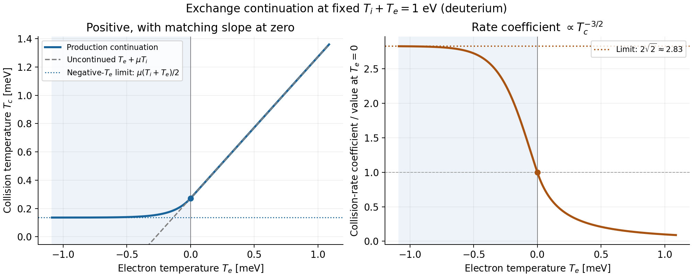

# Ion–electron temperature exchange

The conservative energy transfer is

$$
s=\kappa n^2\frac{T_i-T_e}{T_c^{3/2}},\qquad S_i=-s,\quad S_e=s,
\qquad \mu=\frac{m_e}{m_i}\simeq2.72\times10^{-4}.
$$

The collision coefficient and Coulomb-log approximation are unchanged.
Temperatures use the raw thermal energies, without clipping their difference.

## Collision temperature and negative trials

For $a=\mu(T_i+T_e)>0$, the collision temperature is

$$
T_c=\begin{cases}
T_e+\mu T_i, & T_e\ge0,\\
\dfrac{a}{2}\left[1+\exp\!\left(\dfrac{2(1-\mu)T_e}{a}\right)\right], & T_e<0.
\end{cases}
$$

The negative-electron-temperature continuation joins with matching value and
slope at zero and stays between $a/2$ and $a$. It permits a single-species
Newton undershoot while conserving the transferred energy.

At fixed $T_i+T_e=1$ eV, the continuation keeps $T_c$ positive (left).
The collision-rate coefficient $T_c^{-3/2}$ is normalized to its value at
$T_e=0$ (right); it approaches $2\sqrt{2}$ on the negative side.

| Total thermal energy | Action at positive density |
|---|---|
| Positive: $T_i+T_e>0$ | Evaluate the source, using the continuation when $T_e<0$ |
| Zero or negative | Return a collective retry before assembly |

Nonpositive density or nonfinite plasma states also trigger a retry.

## Linearization

`evaluate_temperature_exchange` returns the source and optional $ds/dU$.
Since $ds/dU\cdot U=2s$, the absolute Newton RHS contribution is simply $s$,
with opposite signs in the two energy equations. Its derivatives enter `Auu`.

The existing `psdtime` multiplier above approximately **1 m²/s** electron
perpendicular diffusion is retained. MMS testcase 2 bypasses this multiplier.
