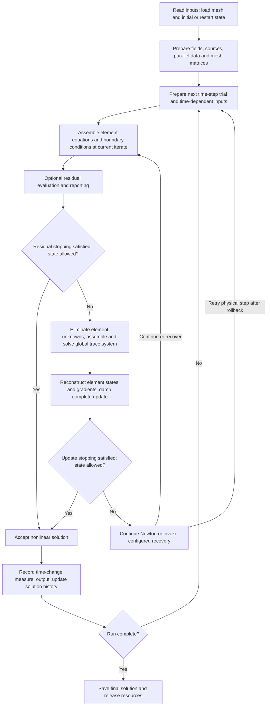

# Solver flow

This is the main `MHDG` driver flow. A Newton iteration changes the solution
at one fixed time endpoint; it does not advance physical time. The complete
iterate consists of element states $U$, gradients $Q$, and face traces
$\widehat U$.

## Assembly, solve and acceptance

Assembly evaluates coefficients and sources at the current iterate and forms
the element matrices and right-hand sides, including time-history terms when
active. Boundary assembly supplies the face equations. Element elimination
(static condensation) leaves a global system for unknown traces; prescribed
traces enter as boundary data. After its solution, local reconstruction recovers
$U$ and $Q$. The damping factor applies to all three fields together.

The [Newton formulation](../numerics/newton-formulation.md) selects an absolute
trial or an increment, with the same assembly/check/solve order.

The default `newton_convergence='update'` checks the existing volume-update
measure after reconstruction and damping. Residual reporting is optional and
does not change that stopping rule. The experimental `residual` and `both`
choices can accept the assembled current state before another solve; `both`
also requires the preceding update to pass. The next assembly checks the state
produced by the previous update, at the same time endpoint. See
[residual evaluation and convergence](../numerics/hdg-residuals.md) for the
norms, controls and precise update measure.

Physical timestep acceptance requires raw-state admissibility. Steady solves
(`steady=.true.`), pseudo-time (`psdtime=.true.`), and initialization without
moving equilibrium may retain evaluable states with negative temperatures,
with a warning. This includes steady solves without diffusion continuation.
These workflows may also retain finite output when the Newton iteration budget
is exhausted; that result remains nonconverged. Recovery checkpoints require
admissible nodal states and an evaluable temperature-exchange source at volume
Gauss points. These checks do not certify positivity everywhere.

## Recovery and outer continuation

Configured Newton recovery can restore a checkpoint or adapt the mesh, project
the solution/history and rebuild mesh-dependent solver data before continuing.
A failed physical step can instead restore the accepted state and retry a
shorter interval when enabled; exhausted recovery stops the run. Optional
prediction supplies an initial guess and falls back to the accepted state if
the predicted solve fails.

Temperature-exchange domain failures before assembly or after an update use
the bounded checkpoint/refinement recovery when available. Without a usable
checkpoint they return a failure; physical timestep control can then reduce
the step. An unevaluable source state cannot be accepted as bootstrap output.

After nonlinear acceptance, the driver evaluates the separate time-change
measure. Transient runs advance history and time; time relaxation can stop at
steady state. Pseudo-time or steady diffusion continuation can reduce
diffusion and solve again. Output and periodic mesh adaptation follow their
configured schedules. See [time stepping](time-stepping.md),
[configuration](configuration.md) and [restart/output](restart-and-output.md).

## Code entry points

| Responsibility | Location |
| --- | --- |
| Startup, outer loop, output and diffusion continuation | [`MHDG.f90`](../../src/MHDG.f90) |
| Time-step trials, Newton loop, damping and recovery | [`Main_utils.f90`](../../src/Utils/Main_utils.f90) |
| Element and boundary assembly | [`hdg_ComputeJacobian.f90`](../../src/HDG/hdg_ComputeJacobian.f90), [`hdg_BC.f90`](../../src/HDG/hdg_BC.f90) |
| Element elimination and global trace assembly | [`hdg_Mapping.f90`](../../src/HDG/hdg_Mapping.f90), [`hdg_Assembly.f90`](../../src/HDG/hdg_Assembly.f90) |
